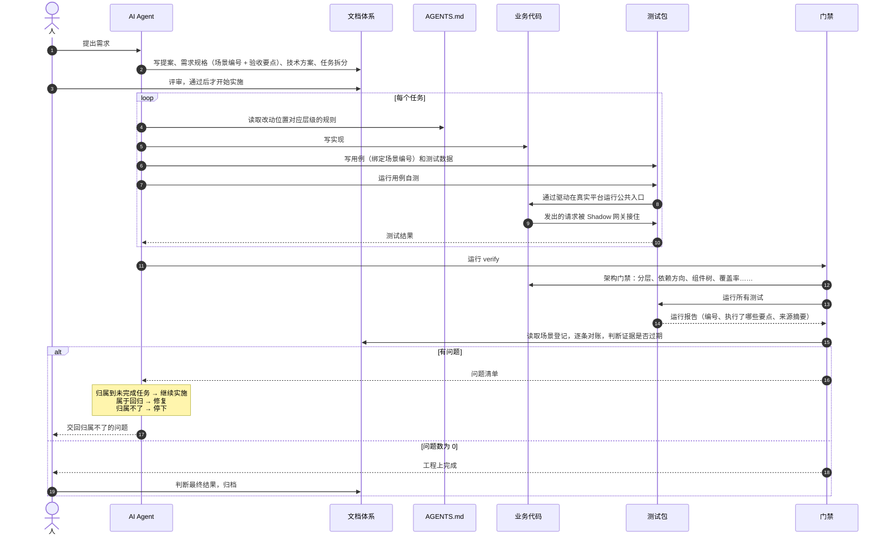

# AI 写的代码，怎么证明它写对了

**当学习成为了习惯，知识也就变成了常识。** 感谢各位的 **关注**、**点赞**、**收藏**和**评论**。

新视频和文章会第一时间在微信公众号发送，欢迎关注：[李永宁lyn](https://gitee.com/liyongning/typora-image-bed/raw/master/202202171742614.jpg)

文章已收录到 [github 仓库 liyongning/blog](https://github.com/liyongning/blog)，欢迎 Watch 和 Star。

**[更多精彩内容](https://github.com/liyongning/blog/blob/main/README.md)**

<hr />

## 问题

有了 AI 之后，coding 速度已不再是问题。一个优秀的工程师一天最多也就写几百到一千行代码，但现在 AI 随随便便就是几千上万行。但随之也出现了新的问题：

1. 发现 AI 写的代码又臭又长，一点都没有古法编程时代的那个熟悉的感觉了（规范）
2. AI 写的对吗？比如需求功能点是不是都实现了？实现的逻辑到底对不对？心里完全没谱（没人兜底、没证据）

那这些问题古法时代就不存在了吗？

### 古法编程时代

其实也存在，只是通过人、规范、流程来兜住了，所以好像问题都不存在了。

先说编码质量问题，一个成熟的研发团队，一定有团队自己的脚手架（项目模板），其中包含了团队的技术栈、模块架构拆分（规范）、编码规范、配套的 lint 工具和 CI 环境，甚至是编辑器，另外核心模块也可能会要求写单测、文档；而流程规范里一定有 Code Review 环节。也就是说古法时代是通过人、脚手架、规范、流程来保障代码质量。

再说需求交付质量（代码写的对不对），其实分两个部分来保障的：

1. **编码质量**：这个阶段的核心保障点是 “人”，是人的经验、能力、对团队规范的遵守落地；
2. **测试环节**：通过 QA 的点点点、自动化测试、部分核心模块的单元测试和 e2e 测试来保障，但说实话，对于大部分的业务团队来说，核心保障点是负责点点点的 QA 同学

这套实施流程稳定运转了十来年，每一步都有 **人** 在场，所有的问题在实施过程中都被人顺手接住了，但 AI 时代呢？

### AI 编程时代

到了 AI 编程时代，负责实施的 **人** 被替换成了 **AI**，而且也经过了三个阶段的发展：

1. **Tab 阶段**：最具代表性的 AI 产品就是 Cursor（AI 编辑器），这个阶段人为主，每行代码还是人在读，古法时代的兜底依然有效，所以那个时候问题不明显。而且那个阶段下编码效率已经出现了 2-3 倍的加持了（古法排期和实际的实施时间对比）；
2. **vibe coding（氛围编程）**：人整个撤出，两个问题直接就暴露出来了。根本原因是：上下文限制、注意力机制、LLM 幻觉，外加系统复杂后三者问题被无限放大，直至迭代不动；
3. **spec coding（规格驱动开发）**：先把需求、方案、验收标准写成文档，经人评审后再交给 Agent 实施，Agent 对照文档干活，而不是凭一句话自由发挥。它解决的是“做什么”说不清楚的问题；

对照古法编程时代会发现，规格对应的只是需求文档和技术方案，但古法时代的质量体系从来不是靠这两份文档来保证的，靠的是后面两个环节里的人。spec coding 把这两个环节交给了 AI Agent，兜底的人却没有换过来：

1. **编码环节**：技术架构、规范约束等大多数在资深同学的脑海或团队规范文档中，这些东西没有写进 Agent 的上下文，对它来说就是不存在；写进去了，受上下文和注意力机制的限制，也不保证每次都照做。比如目录、文件平铺，没有模块结构；跨模块调用别人的内部状态；单文件代码量动辄上千行。代码虽然能跑，但架构在悄悄腐坏，而 Code Review 也没人做了，就变成了大家口中的 **AI 写的屎山代码**
2. **测试环节**：spec coding 范式下，常见的做法是结合 TDD（**Test-Driven Development，测试驱动开发**）范式，但是这个范式下有几个缺口：
   1. 测试层级和覆盖度不够，比如（测试覆盖率不足、缺少集成测试和 E2E 测试）
   2. 自动化测试依赖协作方就绪和配合，无法实现内部自闭环，比如前端依赖后端接口
   3. 已有的这些测试，你不知道是否完整的覆盖住了需求场景 case，即测试用例和 spec scenario（需求场景）匹配和覆盖
   4. 随着需求迭代，spec 和代码逐渐脱轨（不一致），但却没有及时的发现机制，这就会在某一刻突然出现 spec 冲突（需求不一致）或 spec 和现有实现逻辑冲突（需求和实现的差异）

而在古法时代，这些问题通通会有人在某次评审或实施环节被发现，但现在没人看代码了，它们就成了大家担忧的黑洞。

所以，spec coding 只解决了输入，要让人放心地把编码和验证交给 AI，还得给它配上古法时代的另外两样东西：

1. 一套 AI 读得到、违反了会被拦下来的 **脚手架**
2. 一套不依赖 QA 点点点、能用证据说明需求做对、做全了的 **质量体系**

经过上述内容的阅读，相信问题大家应该已经清楚了，接下来就进入解决方案环节了。那这些问题到底怎么解决呢？

## 解决方案

以下内容来自我整理的工程模板 [scenario-driven-baseline](https://github.com/liyongning/scenario-driven-baseline)，由于技术架构比较复杂， 就按照 Monorepo 来组织了（绝非过度设计），它做的就是前面说的那两样东西：给 AI 用的脚手架，和 Spec Coding 时代的质量保障体系。先用两张图把全貌和流程讲清楚，后面再分别展开。

### 架构全景


这张图 **从上往下看** 是一次需求的输入、实现到验收的结构， **从左往右** 看是 “告诉 AI 怎么做 -&gt; AI 做出来的东西（产出物） -&gt; 检查做得对不对” 的结构。

1. 第一排是 **输入**。AI 收到需求之后，开始写 spec（提案、需求规格、技术方案、任务拆分），人评审之后进入实施阶段（基本上核心只关注技术方案）。这套文档在古法时代也有，当前模板则使用  [OpenSpec](https://github.com/Fission-AI/OpenSpec) 来承载，但工具不是重点，换成其他工具也能实施。真正核心的是当前架构方案在 **需求规格** 中（也就是那个红色虚线框）做的扩展，让每一条需求场景（Scenario）都对应一条唯一的编号，并登记了这个场景下要验证哪些点、在哪类测试（单测、集成测试、e2e）里验证。有了这个扩展之后，它就变成了既可以给人看的需求文档，也可以是质量体系中门禁对账的依据，所以图中可以看到一条从扩展到场景门禁的一条绿色虚线。
2. 第二排则是 **实施** 阶段了。左侧的规则是告诉 Agent 当前项目的一些编码规范，对应古法时代团队的技术规范，将这些规范写进按层级展开的 `AGENTS.md` ，根目录写全局规则和项目地图，包级写包内规则，模块级只写模块边界，AI 改到哪儿就读到哪儿。架构图的中间部分则是 AI 产出的代码，分成两部分：
   1. **业务代码**：核心由产品包（就是业务代码，可以有很多个 pacakge）+ 协议包（外部网络通信，可以简单理解为网络请求模块）两部分组成。
   2. **测试包**：这是整套质量体系的核心，也是前面第一排提到的场景编号的承接者。
      1. 其中 Fixture 绑定需求场景编号，Fixture 还负责提供该场景所需的测试数据；
      2. Shadow 网关则承接住项目内的所有对外的请求（即古法时代的 Mock 网关），Shadow 网关的存在让项目可以实现内部闭环不依赖协作方就能跑通全流程；
      3. 驱动负责让业务代码在真实宿主环境（浏览器、小程序开发者工具等）中进行验证；
      4. 运行完之后产出一份报告，记录编号、执行了哪些要点、证据来自哪个版本的需求和代码；

最右侧则是门禁，由统一入口 `verify` 来启动，分成两类：

1. 架构类门禁检查：分层、依赖方向、组件树、覆盖率这些结构上的约束，违反了直接拦下；
2. 场景门禁：拿运行报告和需求规格逐条对账，缺证据、要点对不上、证据过期都不通过；

**最下面是项目清单。** 包、组合绑定、命令、测试项目、源码范围都登记在 `project.manifest.json` 里，测试运行和门禁都从这里读取，而不是写死在脚本里。它是让整套设计能被替换和复用的基础。

**人在图的右上角。** 人做三件事：评审输入、处理门禁归属不了的问题、判断最终结果，不再需要逐行读代码。

图里的颜色也对应了后面的两节：蓝色的规则告知和架构门禁，回答的是前面的问题一，即 AI 写的代码符不符合预期；橙色的测试包和绿色的场景门禁，回答的是问题二，AI 写的代码对不对、需求覆盖面全不全。

### 一次需求交付的流程

全景图是静态的，下面用一次需求交付把各部分串起来：



整个流程分四段。

**规划（1 \~ 3）：**需求进来后，AI 先写文档，不写代码。需求规格里的每条场景的编号和验收要点，在这一步就确认了，后面 AI 可以改实现、改测试的写法，但改不了"要验证什么"，即一旦进入实施阶段，spec 的语义变更就必须重新经过评审。

**实施（4 ~ 10）**：按任务拆分逐个实施。每个任务开始前，AI 读取改动位置对应的 `AGENTS.md`，然后写实现、写用例和测试数据，自己执行用例。其中单测和集成测试用例在 Node 环境下进行，平台类用例通过驱动在真实的宿主环境里进行，业务代码发出的请求都被 Shadow 网关接住，所以这一段不依赖任何外部协作方，AI 在仓库里就能完成写和测。

**验收（11 ~ 15）**：任务做完后运行 `verify`。其中架构门禁负责检查代码质量；所有测试重新运行，产出带编号和来源摘要的运行报告；场景门禁拿报告对照需求规格逐条核对：每条场景是否都有证据，登记的要点是否都执行了，有没有执行了却没登记的要点，证据是否还对应当前版本的需求和代码。

**结果（16 ~ 19）**：门禁的输出不是简单的通过或失败，而是一份问题清单，并且要求每个问题都有归属：

- 能归属到某个还没完成的任务，说明只是还没做完，回到实施段继续做这个任务
- 如果是已完成任务的回归，说明改坏了之前的东西，修复后重新验收
- 归属不了，说明问题超出了评审过的需求和方案能解释的范围，AI 不能自己拍板，停下来交给人

问题数为 0，只代表工程上完成：每条需求都有有效证据，结构上也没有违规。真实服务端的联调和业务验收不在当前方案讨论范围内，最终验收通过后归档。

### 编码质量保障：规则告知 + 架构门禁

古法时代保障编码质量靠的是脚手架、团队规范和 Code Review，其中最关键的一环是人：研发同学记得规范，评审时一眼就能看出哪里有问题。到了 AI 编程时代，这一环面临两个问题：规范如果只在人的脑子里或者团队的规范文档里，AI 根本看不到，就算写进了它的上下文，它也可能没读到、读了没照做。

所以模板对每条重要的规范都做两层处理：先**告知**，把规范写进 AI 每次都会读到的文件里；再**拦截**，用确定性的检查把违反规范的代码挡下来。下面这张图以 Web 产品包为例，把总图里蓝色的两块和它们约束的业务代码放大了：

> - 端口（ports）：业务模块自己声明的能力接口，说明"我需要外部提供什么能力、拿回来是什么形状"，不关心具体怎么实现。模块内的 UI 和核心逻辑只依赖端口
> - 适配器（adapters）：端口的具体实现，负责调用外部世界（比如 OpenAPI 协议包），再把返回的数据翻译成端口约定的形状
> - 用哪个适配器由 main.ts 统一装配，测试时可以换成替身，业务代码不用改


#### 告知：按层级展开的 AGENTS.md

把规范写下来本身并不难，难的是让 AI 读得完、读得准。如果所有规则堆在一个文件里，文件会越来越长，AI 读不完，也分不清哪条规则和当前的改动有关。所以模板的做法是让规则跟着目录走，分成三级：

- **根目录**的 `AGENTS.md` 写全局规则和项目地图，项目地图列出每个包是做什么的、包级规则在哪里
- **包级**的 `AGENTS.md` 写包内规则，比如 Web 产品包的应用分层、状态归属、组件树规则
- **模块级**的 `AGENTS.md` 只写本模块的边界

AI 改到哪个目录，就沿着这条路径读到哪一级的规则，不需要一次读完整个仓库的约定。

还有一条容易被忽略的约定：**长期约定只能落在项目级的载体上**，也就是 `AGENTS.md`、清单、脚本和架构文档，不能只写在某次需求的方案文档里。方案文档会随需求归档，写在里面的约定，下一次需求的 AI 就读不到了。

#### 被约束的对象：先有分层，规则才有落点

规则要有效，前提是代码本身有清晰的结构，每条规则都能落到具体的目录上。图中间是 Web 产品包的分层：

- `main.ts` 是唯一的装配入口，也是唯一读取环境配置的地方，负责组装所有具体实现，再注入给应用
- `app/` 负责把 store、端口实现和各模块的根组件组装起来，跨模块的平台适配放在 `app/platform/`
- 每个业务模块内部分成 `ui/`、`core/`、`ports/`、`adapters/`：UI 只依赖核心逻辑，核心逻辑只依赖端口，适配器实现端口
  - ports：业务模块自己声明的能力接口，说明"我需要外部提供什么能力、拿回来是什么形状的数据"，不关心具体怎么实现
  - adapters: 端口的具体实现，负责调用外部世界（比如 OpenAPI 协议包），再把返回的数据翻译成端口约定的形状
- `store/` 是唯一的全局 store，对外只暴露只读状态和 action；状态按"谁读、谁写"分层，组件自己的状态留在组件里，模块的状态留在模块根，只有跨模块的状态才进全局 store
- `shared/` 放跨模块共享的代码，`runtime/` 放不依赖 Vue 和 DOM 的纯逻辑

图里的红色虚线是明确禁止的依赖：UI 不能直接引用适配器或协议包，业务模块之间不能互相引用。

这一层就是 AI 时代的脚手架。分层、依赖方向、状态放哪，这些决策在模板里已经定好，AI 照着放就行，不用每次新开会话都重新决策一遍。核心逻辑只依赖端口还有一个好处：测试时可以在端口背后换上替身，这一点在后面的质量体系里会用到。

#### 拦截：架构门禁

**规则告知** 解决的是 AI 知不知道，拦截解决的是 AI 做没做到。图右边是 Web 产品包涉及的几类架构门禁：

- **依赖巡航**：用 dependency-cruiser 检查分层方向和模块隔离，比如核心逻辑引用了平台代码、模块 A 引用了模块 B
- **组件树检查**：入口组件是否唯一、子组件有没有反向引用父组件所在的子树、有没有不被任何组件使用的孤儿组件
- **ESLint**：平台全局对象只能在宿主目录出现；源文件不超过 300 行、测试文件不超过 600 行，超了要拆，确实拆不了的豁免必须集中登记在清单里并写明理由
- **覆盖率检查**：手写代码（AI 写的也叫手写）要求 100% 覆盖，产品代码里禁止用注释忽略覆盖率
- **项目地图检查**：每个包和模块是否都有对应的 `AGENTS.md`，项目地图的列表是否和实际目录一致

最后一项值得单独说一下：**AGENTS.md 本身也受门禁保护**。如果 AI 新增了一个模块却没有写对应的规则文件，或者项目地图漏掉了新包，后面再改这里的 AI 就读不到规则了，告知这一层会悄悄断掉。所以规则文件的结构也要被门禁核对。

做这些门禁的过程中，发现一件事：**门禁本身也可能是空的**。有两个例子：

- 模板最早的分层守卫只匹配示例目录，按照示例新增的业务模块，悄悄就脱离了约束。后来改成按目录名（`core/`、`ports/`）自动覆盖 `src/` 下所有业务模块，没有采用逐个模块登记的白名单，因为白名单要求每新增一个模块都去改配置，而这一步迟早会被忘掉。每条规则也要用一个故意违规的反例证明它真的会拦，而不是看配置写得对不对
- 覆盖率显示 100%，实际上有整个文件根本没有被统计进去，原因是统计范围靠 glob 维护，漏配一个路径，文件就静默缺席了。后来改成统计范围由手写源码清单派生，排除项只能登记在清单里并写明理由

所以 **门禁不只要检查代码，还要能证明自己确实检查到了**。

#### 门禁的边界

架构门禁只能检查**结构**：依赖方向对不对、文件放在哪、规则文件在不在。下面这些问题它判断不了：

- 一个组件放在这个模块下是否合理
- 一条规则本身定得对不对
- `AGENTS.md` 里写的内容是否准确

这些仍然要由人来评审。区别在于，人不再需要逐行读代码，去找哪里调错了层、哪个文件太长了，这些机器已经拦下来了。人要看的是规则本身，以及机器判断不了的设计取舍。

### 质量体系：从需求场景到场景门禁

古法时代，需求做没做对、做没做全，最终是 QA 同学按用例测出来的。AI 编程时代需要换一种方式回答这个问题：**每条需求都要有证据，证据要能和需求逐条对上，并且得是最新的。**

前面问题部分列的测试环节的缺口，在这里都要有着落：测试不知道是否覆盖了需求场景、需求变了旧测试照样通过、测试依赖协作方没法自闭环。模板的做法是让需求场景的编号成为一条主线，从需求规格出发，经过测试数据、Shadow 网关、用例，一直带到运行报告，最后由场景门禁按编号对账。下面这张图以模板示例里的一条需求场景 **交易状态轮询到终态后停止**（`SCN-WEB-EXAMPLE-002`）为例，把总图里橙色和绿色的部分沿着这条主线展开：


#### 起点：给需求场景加上验证登记

OpenSpec 的需求规格由需求（Requirement）和场景（Scenario）组成，每个场景用 WHEN / THEN 描述行为，这是写给人看的。模板在这之上加了一条硬规则：**每个场景必须带一个 `json verification` 块**，把"怎么才算验证了这个场景"写成机器能读的结构。以图中这条场景为例：

```json verification
{
  "formatVersion": 2,
  "checkpoints": {
    "poll-uses-trade-no": "轮询请求使用当前交易的 trade_no 作为路径参数",
    "pending-shown": "非终态期间页面展示进行中状态",
    "terminal-stops": "收到终态后展示终态并停止轮询，之后不再发出 getTrade，verify 无问题"
  },
  "cases": [
    {"key": "status-view", "kind": "module", "requiredIn": ["app-unit"], "checks": ["pending-shown", "terminal-stops"]},
    {"key": "poll-in-browser", "kind": "behavior", "requiredIn": ["browser"], "checks": ["poll-uses-trade-no", "pending-shown", "terminal-stops"]}
  ],
  "blockedBy": []
}
```

它回答了三个问题：

- **要验证什么**：`checkpoints` 是这个场景的检查点，每个检查点是一条可以判断对错的验收要点
- **用哪类测试验证**：`cases` 里每个 case 声明自己的类别 `kind`，`behavior` 是从公共入口验证用户可见的行为，`module` 是验证模块内部的正确性
- **在哪里验证**：`requiredIn` 指定 case 必须在哪个测试项目里运行，比如 `browser` 表示必须在真实浏览器里跑

场景编号的格式由项目配置决定，模板默认是 `SCN-<能力>-<三位序号>`。

这一块属于需求规格，和需求一起经过评审。评审通过后，**要验证什么就被锁定了**：AI 在实施阶段可以改实现、改测试的写法，但想删掉一个检查点，或者把 `kind` 从 `behavior` 改成 `module`、把 `requiredIn` 里的 `browser` 换成单测项目来降低验证要求，就得改需求规格，而已评审的输入发生语义变更，要重新经过评审。这也是总图里那条虚线的意思：场景登记是后面对账的依据。

#### 测试数据和 Shadow 网关：端侧自闭环

问题部分说过，自动化测试依赖协作方就绪（构造环境和数据更复杂），比如前端要等后端接口。古法时代的解法是 mock，模板把它做成了一套有约束的标准，叫做端侧内部自闭环：**所有跨边界的交互都由替身接住，AI 在仓库里就能把写和测跑完。**

图中第 ② ③ 步是这一段：

- **测试数据（Fixture）** 按场景编号组织，每份测试数据都声明自己属于哪个场景，并记录所属需求块的摘要。需求一改，摘要就对不上了，`check:fixtures` 会直接报出来，要求重新确认这份数据还对不对，旧 mock 数据不会再悄悄地继续被用下去
- **Shadow 网关：**按测试数据编排接口的返回。这条场景里，`getTrade` 先返回非终态，再返回终态，用来验证页面能不能正确轮询和停止。Shadow 网关还会记录页面发出的每个请求，用来核对请求参数、调用顺序和次数。Shadow 网关返回的响应要和接口契约同形，不同形的响应在构造时就会被拒绝
- **平台能力**由产品包定义端口，测试时注入平台能力替身；**驱动和宿主**让平台类用例在真实的 Chromium 或微信开发者工具里运行，网络请求走的是真实的平台网络请求，最后落到 Shadow 网关上

这里有一个刻意的取舍：模板只提供一种闭环，服务端接口全部由 Shadow 网关承载，平台能力全部由端口注入测试替身承载，**不支持一部分走 Shadow 网关、一部分走真实服务提供方的混合模式**。混合模式下，一个用例通过了，你说不清它依赖了哪部分真实环境，证据也就没法复现。真实服务的联调和业务验收，交给使用模板的真实项目去做。

Shadow 网关还有一个用处：本地预览。`pnpm preview:local` 用一份单独维护、同样经过契约校验的预览数据集，把页面停在某个指定的状态，人不改产品代码、不发真实请求，就能直接看到这个状态下的页面是什么样子。

#### 用例和运行报告：证据要能说清验证了什么

图中第 ④ 步是用例。模板里的用例通过 `defineCase` 声明自己和需求场景的绑定关系：

```ts
defineCase(
  {
    ownerId: 'SCN-WEB-EXAMPLE-002',
    caseId: 'poll-in-browser',
    fixtureCase: 'poll-in-browser',
    environment: 'browser',
    binding: 'web-openapi-browser',
    covers: [
      {
        id: 'SCN-WEB-EXAMPLE-002',
        caseKey: 'poll-in-browser',
        checks: ['poll-uses-trade-no', 'pending-shown', 'terminal-stops'],
      },
    ],
  },
  async ({ fixture, checkpoint, expect }) => {
    // ... 每个检查点用 checkpoint('<名称>', () => { /* 断言 */ }) 包起来
  },
);
```

`covers` 声明了这个用例覆盖哪个场景的哪个 case、哪几个检查点。但声明不等于执行：运行时，只有真正执行到的 `checkpoint` 才会被上报。

图中第 ⑤ 步是运行报告。每次运行结束，报告器记下每个用例的场景编号、case、实际执行了哪些检查点、结果是通过、失败还是跳过，以及四类来源摘要：源码、需求、协议、测试数据。有了这些摘要，报告就和"产出它的那个版本"绑定在了一起。

#### 场景门禁：对账、过期和归属

图中第 ⑥ 步是场景门禁。它拿需求规格里的登记，和运行报告逐条对账，以下任何一种情况都算问题：

- **缺证据**：需求规格里登记的 case 没有对应的报告，或者报告来自错误的测试项目，比如要求在 `browser` 里验证，实际只在单测里跑了
- **要点对不上**：这是双向的。登记了的检查点没有执行是问题，执行了却没登记的检查点也是问题。后者说明测试和需求已经出现偏差，要么需求漏了，要么测试测了需求之外的东西
- **证据过期**：报告里的四类来源摘要，只要有一类和当前仓库不一致，这份报告就作废。需求改了、代码改了、契约改了、测试数据改了，都需要重新运行、重新产出证据。这是对问题部分"spec 和代码逐渐脱轨"的回答：脱轨不再需要某一天突然撞上，它在发生的那次运行里就会被报出来
- **证据不算数**：跳过的用例、没有任何断言的用例都不算覆盖；`module` 类的内部单测也不能抵扣 `behavior` 类的行为验证。AI 写了一堆内部函数的单测，不能代替从公共入口对用户可见行为的验证

问题数为 0，门禁才通过。有问题时，门禁不只是报一个失败，而是要求**每个问题都有归属**：能归属到还没完成的任务，就继续做；属于回归，就修复；归属不了，就停下来交给人。这一点在前面的流程里已经讲过，它的意义在于：AI 不能用"这个问题和我无关"来跳过一个失败的门禁。

做这套门禁的过程中，我们也遇到过门禁本身有漏洞的情况。比如第一个真实项目接入后发现，测试执行了需求里没有登记的检查点，没有任何地方会报出来，后来才把检查点改成双向对账。所以和架构门禁一样，场景门禁的规则也要有反例用例来证明它确实会拦。

#### 质量体系的边界

场景门禁能证明的是：**每条登记的需求场景都有一份有效的、最新的、逐条对上的证据**。它证明不了另外两件事：

- **断言本身是否有效**。一个检查点执行了，不代表它的断言真的能发现错误。模板在测试包的 `AGENTS.md` 里写了要求：测试的期望必须来自需求规格、契约和方案，不能从现有实现、返回值或测试数据反推；对每条断言都要问一句"如果实现以某种方式出错，这条断言会失败吗"。但这只是告知，真正的保障要靠研发工作流里提案和评审的角色拆分，这部分后面单独写
- **需求本身是否正确**。门禁对账的依据是需求规格，需求写错了，门禁只会忠实地验证一个错误的需求。这一层仍然要靠人在评审时把关

## 模板与总结

### 模板怎么用

上面讲的整套架构，都已经沉淀在模板仓库 [scenario-driven-baseline](https://github.com/liyongning/scenario-driven-baseline) 里。它的规模不小，第一次接触直接读代码会比较吃力，更推荐的方式是让你自己的 AI 帮你读。仓库里有三份入口文档，分工是固定的：

- **根目录的 `AGENTS.md`**：Agent 的入口，写全局规则和项目地图。AI 打开仓库时会先读它
- **使用指南 `docs/template-guide.md`**：回答"怎么用、怎么换"，包括能力地图、从方案到验收的流程、初始化方式、替换点地图
- **架构文档 `docs/architecture.md`**：回答"解决什么问题、为什么这样设计"，能力地图里的每一项都有一节同名说明，写了实现机制、被否决的方案和演进记录

想了解某个设计为什么是这样，可以让 AI 去架构文档里找对应的那一节；想把模板用到自己的项目里，使用指南的"初始化方式"一节写了推荐的步骤。其中有一步叫**适配评估**：在改任何代码之前，先让 AI 读使用指南和你自己的产品方案、技术方案，对能力地图的每一行和替换点地图的每一项给出结论（保留、替换、删除还是新增），再列出你的项目需要、但模板没有的能力。这份结论经你评审后，作为第一个需求的输入。

模板当前并列提供了"Web 应用 + OpenAPI + 浏览器"和"SDK + IDL + 小程序"两套实现，产品形态、协议来源和运行平台都可以按替换点地图换掉，IDL 和 OpenAPI 可以互换，即浏览器中可以用 IDL 或小程序也可以用 OpenAPI。

接入过程中遇到问题，欢迎到仓库提 issue；也可以关注文末的公众号，加入交流群一起讨论。

### 人的角色

回到开头的问题：AI 写代码之后，人做什么？

在这套架构里，人不再需要逐行读代码来确认 AI 做没做对、做没做全，这件事交给了门禁。人要负责的是门禁管不到的部分：

- **定义正确**：评审需求规格，尤其是每个场景的检查点和验证方式，这是后面所有对账的依据
- **定规则**：分层怎么划、依赖方向怎么定、哪些约束要写进 `AGENTS.md`、哪些要落成门禁
- **评审方案**：AI 出的技术方案和任务拆分，由人确认后再实施
- **处理归属不了的问题、判断最终结果**：门禁报出 AI 无法归属的问题时由人拍板；问题数为 0 之后，真实环境的联调和业务验收也由人判断

这些事恰恰都需要扎实的技术功底：验收要点写不清楚，门禁就没有可对账的东西；规则定得不对，AI 就会严格地执行一套错误的规范。所以在 spec coding 的模式下，**资深开发并没有变得不重要，他们的工作从写代码和读代码，转移到了定义正确和制定规则上**。

### 总结

文章开头提了两个问题：AI 写的代码又臭又长，AI 写的对不对心里没谱。古法时代，这两个问题由脚手架、规范、Code Review 和 QA 兜住，核心是每一步都有人在场。spec coding 把需求和方案写清楚了，但编码和测试环节的兜底并没有跟着换过来。

scenario-driven-baseline 给出的答案是两部分：

- **编码质量**：把规范写进按层级展开的 `AGENTS.md`，告诉 AI 怎么写；再用架构门禁把违反规范的代码拦下来。规则文件本身也受门禁保护，门禁本身也要用反例证明确实会拦
- **质量体系**：给每条需求场景加上机器可读的验证登记，以场景编号为主线，贯穿测试数据、Shadow 网关、用例和运行报告，由场景门禁逐条对账；证据和来源绑定，来源一变即作废；所有跨边界的交互都由替身接住，AI 在仓库里就能完成写和测

两者的共同点是：**把原来依附在人身上的隐性保障，变成写下来的规则和确定性的检查**。人从逐行读代码中退出来，去做机器做不了的判断。

这些思想不依赖前端，也不依赖 OpenSpec。换到服务端或 Agent 开发，分层和依赖方向一样可以写成规则、落成门禁；需求场景一样可以加上验证登记，由门禁按编号对账；外部依赖一样可以用替身接住。模板只是这套思路在端侧的一种实现。

## 代码仓库

- [scenario-driven-baseline](https://github.com/liyongning/scenario-driven-baseline)：本文方案的完整实现，MIT 协议，**欢迎 Star** 和提 issue

<hr />

**当学习成为了习惯，知识也就变成了常识。** 感谢各位的 **关注**、**点赞**、**收藏**和**评论**。

新视频和文章会第一时间在微信公众号发送，欢迎关注：[李永宁lyn](https://gitee.com/liyongning/typora-image-bed/raw/master/202202171742614.jpg)

文章已收录到 [github 仓库 liyongning/blog](https://github.com/liyongning/blog)，欢迎 Watch 和 Star。

**[更多精彩内容](https://github.com/liyongning/blog/blob/main/README.md)**
